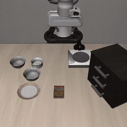
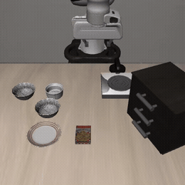

# Backstop

**Runtime failure prediction for Vision-Language-Action robot policies.**

A VLA policy takes camera images and a natural-language instruction and emits robot
actions directly. It generalises impressively, and it fails silently — the policy does
not know it is about to close the gripper on empty air. It emits the same well-formed
action stream either way.

Backstop is the supervisory layer: a runtime monitor that predicts execution failure
*before* the arm commits to it. It does not replace the policy. It watches the policy
and decides whether to trust the next action chunk.

---

## The problem, in two clips

Same task, same policy, adjacent starting scenes. Nothing in the policy's output
distinguishes them.

| Success — 100 steps | Failure — 280 steps (timeout) |
|:---:|:---:|
|  |  |
| Grasps the bowl, places it on the plate | Approaches, never secures the bowl, runs out the clock |

*Both from the recorded corpus, LIBERO-Spatial task 0, seeds 0 and 1. Failure clip is
2× speed. Camera is the agentview render at 20 Hz.*

The policy is equally confident in both. An operator watching only the action stream
has no signal that the second episode is going wrong. That missing signal is the
project.

---

## Status

**Week 6 of 6: guard built and evaluated; hosted viewer and taxonomy write-up outstanding.**

### Headline

Headline metric, fixed in [ADR-005](docs/adr/005-headline-vs-stopwatch.md): how much
sooner the guard ends a failing run than a plain stopwatch would, with both held to the
same 5% false-stop budget.

| | |
|---|---|
| **Saved over a stopwatch** | **13.4 steps (0.67 s)** on average, 10th–90th percentile −1.4 to 25.9 steps |
| Splits where the guard did no better than the clock | 3 of 20 |
| Held-out false-stop rate | 4.3% (budget 5%) |
| Failures caught | all of them (the clock guarantees it) |

*Guard: action-chunk disagreement OR stopwatch, both set from good runs only. LIBERO-Spatial
corpus A, held-out half, 20 random splits. Details in [evaluation](docs/evaluation.md).*

**Why a stopwatch is the baseline.** Every failure in the corpus stalls until the
280-step cap, and good runs finish by about step 130. So "stop anything still running
at step 132" already catches every failure inside the budget. The learned trust head,
which the original plan made the headline, caught 34 of 41 held-out failures and saved
less time than the single disagreement signal. On failures caught, the guard barely
beats a timer. What it adds is time.

**What that says about the hypothesis.** The signals do carry information: by the end of a
run they separate failures from good runs well (about 0.8–0.9, where 0.5 is a coin flip), and perturbed runs that succeed score like
clean ones, so the guard is not just reacting to a changed scene. But at the moment a
reviewer marks a failure as starting (around step 40), the signals barely tell it apart
from a good run. The guard fires before the clock on about half the failures. On the
rest it cannot see the failure coming any earlier than the clock does.

**Other results:**

- The thresholds do not transfer to an unseen suite (LIBERO-Object): its good runs are
  slower and score higher. Recalibrating from about 40 good runs in the new setting, with
  no failures needed, brings the false-stop rate back under 5%.
- The visual precondition check works as a per-object gate on an open-vocabulary
  detector. It stops 28 of 30 runs whose instructed object is missing before the arm
  moves; the headline guard stops them about 4 seconds in. It needs reference frames from
  the same scenes it runs in, and it cannot tell some lookalike grocery cartons apart.
  CLIP and SmolVLM2 did not work at all.
- Single-split numbers overstated the guard. The trust head's false-stop rate on the
  reported split (2.9%, later 4.3%) averages about 6% over 20 splits.

### Reproduced baseline

`HuggingFaceVLA/smolvla_libero` (frozen) on LIBERO-Spatial, 10 tasks × 10 episodes:

| | |
|---|---|
| **Policy success rate** | **70.0%** (70/100) |
| Tolerance band (set before any number existed) | 70–90% |
| Failures | 30, **all** at the 280-step cap |
| Corpus | 100 episodes, 15,880 frames |

Per-task, showing that difficulty is very unevenly distributed:

| task | 0 | 1 | 2 | 3 | 4 | 5 | 6 | 7 | 8 | 9 |
|---|---|---|---|---|---|---|---|---|---|---|
| success | 8/10 | 8/10 | 8/10 | **4/10** | 8/10 | 7/10 | 8/10 | 6/10 | 9/10 | **4/10** |

**An honest caveat:** 70.0% sits exactly on the lower edge of the tolerance band. It is
inside, and the band was fixed in [ADR-002](docs/adr/002-checkpoint.md) before any
number was measured — but it is the floor, not the middle, and roughly 11 points under
the 81.5% pinned reproduction cited there. Treat it as reproduced-but-weak.

**A finding that shapes Week 2:** every one of the 30 failures ran the full 280 steps.
None terminated early. The policy never does something catastrophic and stop — it
stalls, retries, and never satisfies the success condition. So the *natural* failure
mode is a single category, which is not much of a taxonomy. Week 2's perturbations need
to produce genuinely distinct failure modes rather than more of the same.

---

## How it works

```
policy checkpoint
      ↓
LIBERO rollout (MuJoCo, Franka Panda)   ← perturbation injection (week 2)
      ↓
recorded episodes: per-step observations + action chunks + K samples
      ↓
offline guard training and evaluation   ← src/backstop/guard, scripts/evaluate_*.py
      ↓
exported artifacts → web viewer          ← local only (scripts/guard_viewer.py)
```

Rollout generation is slow and runs once. Guard development runs against recorded
episodes and iterates in seconds. Recording early is a cost control, not just an
engineering convenience.

### Signals

| Signal | What it detects | Result |
|---|---|---|
| Action-chunk disagreement | Sample the policy K times under different flow noise; high spread means no confident opinion about what to do next | Carries signal. Headline guard. |
| Temporal self-consistency | Chunks from successive timesteps overlap; disagreement in the overlap means the policy is changing its mind mid-motion | A tie with disagreement, not simpler. Archived. |
| Visual precondition check | Verify the instructed object is actually present before committing | Works as a per-object detector gate (OWLv2) when its references come from the same scenes: stops 28 of 30 missing-object runs at step 0. Lines do not carry over to new layouts. |
| Progress monitoring | Compare predicted against observed state change | Weak. Archived. |
| Trust head | Logistic combination of the action-stream signals | Catches the most failures on its own, but as a guard OR stopwatch it saves less time than disagreement alone (0.47 s vs 0.67 s). Combines the three action-stream signals; the visual check is a separate gate. Archived. |

Persistence rules, signals from recent papers, the model's own activations, a per-step
model and the privileged cup position were tried too. Every archived experiment is
written up in [experiments](docs/experiments.md), with its code at the git tag
`research-archive-2026-10`.

Each was evaluated on its own before any combination. The per-signal ablation matters
as much as the combined number, because it says which signal is doing the work.

### The metric

Raw accuracy is the wrong measure: a guard that halts everything catches every failure
and is useless. The false-stop budget is 5% of runs that would have succeeded, fixed in
writing ([ADR-001](docs/adr/001-metric.md)) in week 1 before any guard number existed.

ADR-001's headline was the share of failures caught within that budget. Once it turned
out a stopwatch catches all of them, that number stopped saying anything about the
signals. [ADR-005](docs/adr/005-headline-vs-stopwatch.md) replaced it with time saved
over the stopwatch at the same budget, kept the old number as a secondary metric, and
required results over 20 splits rather than one. Both are enforced in code:
`write_guard_report()` only accepts the locked headline and raises on `accuracy`,
`raw_accuracy`, or `success_rate`, and CI fails if the budget drifts off 0.05.

---

## Recorded data format

LeRobot v3 dataset, one row per control step at 20 Hz:

| Field | Shape | Notes |
|---|---|---|
| `observation.images.image` | (360, 360, 3) | agentview |
| `observation.images.image2` | (360, 360, 3) | wrist camera |
| `observation.state` | (8,) | eef position (3) + axis-angle (3) + gripper qpos (2) |
| `action` | (7,) | executed 6-DoF delta + gripper |
| `action_chunk` | (50, 7) | the policy's full plan at this step |
| `action_chunk_samples` | (K, 50, 7) | K plans under different flow noise |
| `next.success` | (1,) | episode outcome |

The last two columns are why this repo owns a rollout loop instead of calling
`lerobot-eval`: LeRobot's evaluation computes the action chunk, executes its first step,
and discards the rest. Backstop is about what the policy was *planning*, so the chunk
has to be persisted.

---

## Setup

Requires Python 3.12 (LeRobot 0.6.x needs `>=3.12`), a CUDA GPU, and `libosmesa6`.

```bash
uv sync --extra dev --extra sim
```

Rendering uses OSMesa (CPU, off-screen) rather than EGL so that GPU memory goes entirely
to policy inference — the reference machine is an 8 GB RTX 4070 Laptop. Nothing opens a
window; episodes are written to disk as video.

```bash
# 2-episode smoke, ~5 min
MUJOCO_GL=osmesa PYOPENGL_PLATFORM=osmesa uv run backstop-eval --config configs/eval/spatial_smoke.yaml

# verify the recorded data is actually what it claims to be
uv run python scripts/verify_corpus.py \
  --artifacts artifacts/eval/spatial_smoke \
  --dataset data/lerobot/backstop_spatial_smoke

# full baseline + corpus in one pass, ~1.5 h
MUJOCO_GL=osmesa PYOPENGL_PLATFORM=osmesa uv run backstop-record --config configs/record/spatial_baseline.yaml
```

With [`just`](https://github.com/casey/just) installed (`uv tool install rust-just`)
these become `just smoke`, `just verify-smoke`, `just record-spatial`.

### `verify_corpus.py`

Not optional. Every check in it maps to a defect that once shipped silently — zeroed
action chunks, a state vector holding rotation-matrix entries, upside-down video,
actions that skipped the unnormalize step, a benchmark asset path that suppressed the
scene meshes. None of those raised an exception; all of them produced a plausible-looking
dataset. Run it after every recording run.

---

## Roadmap

| Week | Deliverable | Status |
|---|---|---|
| 1 | Rollout infrastructure, reproduced baseline, stored corpus | **done** |
| 2 | Perturbation injection, labelled corpus, failure taxonomy | corpus and labels **done**; `docs/taxonomy.md` not written |
| 3 | All four signals implemented and independently ablated | **done** (visual check negative) |
| 4 | Trust-score head, threshold calibration, held-out evaluation | **done** |
| 5 | Hosted interactive rollout viewer | local viewer only, not hosted |
| 6 | Evaluation report and write-up | report **done** ([evaluation](docs/evaluation.md)); write-up in progress |

Explicitly out of scope: real hardware, recovery behaviour (the guard halts and flags,
it does not replan), any policy fine-tuning, and comparing multiple policy architectures.

**The central hypothesis may be false.** Failure may not be predictable from signals the
policy already produces. That is why the failure taxonomy is scoped as an independent
Week 2 deliverable rather than a by-product of Week 4 — a categorised public catalogue of
VLA failure modes is a genuine contribution even if the guard does not work.

---

## Documentation

- [Runbook](docs/runbook.md) — commands, tolerances, machine setup
- [Evaluation](docs/evaluation.md) — the guard's results, with commands to reproduce them
- [Experiments](docs/experiments.md) — every signal and rule we tried, what it scored, and why it lost
- [Refactor plan](docs/refactor_plan.md) — staged clean-up of the code structure
- [ADR-001](docs/adr/001-metric.md) — the 5% false-stop budget
- [ADR-005](docs/adr/005-headline-vs-stopwatch.md) — why the headline is time saved over a stopwatch
- [ADR-002](docs/adr/002-checkpoint.md) — why SmolVLA over OpenVLA-7B, and the locked recipe
- [ADR-003](docs/adr/003-perturbation-schema.md) — perturbation schema and privileged sim state
- [ADR-004](docs/adr/004-guard-calibration.md) — calibrate on one half, measure on the other
- [Failures](docs/failures.md) — natural failures from the baseline run

## License

Apache-2.0
