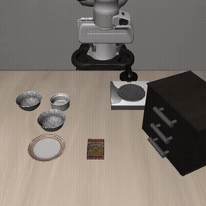
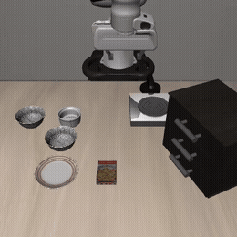

# Backstop

**Runtime failure prediction for Vision-Language-Action robot policies.**

A VLA policy takes camera images and a natural-language instruction and emits robot
actions directly. It generalises well, and it fails silently: it does not know it is
about to close the gripper on empty air, and its action stream looks the same either way.

Backstop is a supervisory layer. It watches a frozen policy while it runs and decides
whether to trust what the policy does next, stopping a run that is going wrong earlier
than a timeout would. It does not modify or retrain the policy.

---

## The problem, in two clips

Same task, same policy, adjacent starting scenes. Nothing in the policy's output
distinguishes them.

| Success — 100 steps | Failure — 280 steps (timeout) |
|:---:|:---:|
|  |  |
| Grasps the bowl, places it on the plate | Approaches, never secures the bowl, runs out the clock |

*Both from the recorded corpus, LIBERO-Spatial task 0, seeds 0 and 1. The failure clip is
shown at 2× speed. Camera is the agentview render at 20 Hz.*

---

## Results

### Headline

The headline metric ([ADR-005](docs/adr/005-headline-vs-stopwatch.md)) is how much sooner
the guard ends a failing run than a plain stopwatch would, with both held to the same 5%
false-stop budget.

| | |
|---|---|
| **Saved over a stopwatch** | **13.4 steps (0.67 s)** on average; 10th–90th percentile −1.4 to 25.9 steps |
| Splits where the guard did no better than the clock | 3 of 20 |
| Held-out false-stop rate | 4.3% (budget 5%) |
| Failures caught | all of them |

*Guard: action-chunk disagreement OR stopwatch, both set from good runs only. LIBERO-Spatial
corpus, held-out half, 20 random splits. Details in [evaluation](docs/evaluation.md).*

**Why a stopwatch is the baseline.** Every failure in the corpus is a stall that runs to
the 280-step cap, and good runs finish by about step 130. "Stop anything still running at
step 132" therefore catches every failure inside the budget. Measured by failures caught,
no signal can beat that. What a signal can add is time, so time saved over the clock is
the headline.

**What that says about the hypothesis.** The signals carry information: by the end of a
run they separate failures from good runs well (AUROC about 0.8–0.9), and perturbed runs
that succeed score like clean ones, so the guard is not just reacting to a changed scene.
But at the point a reviewer marks a failure as starting (around step 40), the signals
barely separate it from a good run (AUROC about 0.65). The guard fires before the clock on
about half the failures. On the rest it sees the failure no earlier than the clock does.

### Other results

- **Unseen suite (LIBERO-Object).** Thresholds do not transfer: object-suite good runs are
  slower and score higher, and the frozen spatial rule stops 17% of them. Recalibrating
  from about 40 good runs in the new suite, with no failures needed, brings the false-stop
  rate back under 5%. The signal carries over; its level does not.
- **Missing-object check.** A per-object gate on an open-vocabulary detector (OWLv2)
  stops 28 of 30 runs whose instructed object is absent before the arm moves; the headline
  guard stops them about 4 seconds in. It needs reference frames from the same scenes and
  cannot tell some lookalike grocery cartons apart. CLIP and SmolVLM2 did not work.
- **Single splits overstate guards.** A learned trust head looked inside the budget on
  the reported split (2.9%) and averaged about 6% over 20 splits. Every number here is
  reported over 20 splits for that reason.
- **Recovery does not help this policy.** When the guard fires, lifting the arm and
  backing off, then letting the policy try again, rescued 1 of 19 failures and spoiled 1
  good run, a paired change of 0 (McNemar p = 1.0). The policy returns to the same stall a
  median of 33 steps after each recovery. See [Recovery](#recovery) below.

### Reproduced baseline

`HuggingFaceVLA/smolvla_libero` (frozen, pinned revision) on LIBERO-Spatial, 10 tasks × 10
episodes:

| | |
|---|---|
| **Policy success rate** | **70.0%** (70/100) |
| Tolerance band (fixed before any number existed) | 70–90% |
| Failures | 30, **all** at the 280-step cap |

| task | 0 | 1 | 2 | 3 | 4 | 5 | 6 | 7 | 8 | 9 |
|---|---|---|---|---|---|---|---|---|---|---|
| success | 8/10 | 8/10 | 8/10 | **4/10** | 8/10 | 7/10 | 8/10 | 6/10 | 9/10 | **4/10** |

70.0% sits on the lower edge of the band set in [ADR-002](docs/adr/002-checkpoint.md), and
about 11 points under the 81.5% reproduction cited there. It is reproduced, but weak.

---

## The corpus

Every failure the policy makes on its own is the same stall, which is not enough to study.
The corpus therefore makes the environment harder in named ways, each tuned so that
roughly half its episodes still succeed. A family that always failed would teach a guard
to detect the perturbation rather than the failure.

| Shard | What changes | Episodes | Success |
|---|---|---:|---:|
| clean | nothing | 100 | 70 |
| lighting | scene lights and camera headlight dimmed and moved | 50 | 35 |
| camera | agentview camera pose and field of view jittered | 50 | 29 |
| object_pose | object positions and yaw jittered, then settled | 50 | 28 |
| distractor | an extra object compiled into the scene | 50 | 33 |
| action_noise | Gaussian noise on the executed action | 50 | 33 |
| language_absent | instruction names an object that is not there | 30 | 0 |
| language_paraphrase | instruction reworded, same task (control) | 20 | 3 |
| object_clean | unseen suite (LIBERO-Object), held out | 100 | 83 |

`language_absent` fails by construction and is reported separately, never pooled.
`language_paraphrase` was meant as a neutral control and was not: rewording the task-0
instruction cut success from 8/10 to 3/20, so the policy is sensitive to phrasing alone.

Each episode also stores the full MuJoCo state at every step, outside the dataset, for
labelling and for branching experiments. It is never a guard input
([ADR-003](docs/adr/003-perturbation-schema.md)).

---

## How it works

```
frozen policy (SmolVLA) ──► LIBERO rollout (MuJoCo, Franka Panda) ◄── perturbation families
                                      │
                                      ▼
            recorded corpus: observations, executed action, full action chunk,
            K=4 sampled chunks per step; sim state kept in a separate sidecar
                                      │
                ┌─────────────────────┼──────────────────────┐
                ▼                     ▼                      ▼
     guard calibration and      labelling and review     recovery experiments
     evaluation (offline)       (auto-proposals, local   (branch from a recorded
                                review tool)             state, paired comparison)
                │
                ▼
     frozen rule ──► OnlineGuard, step by step (Python, and a C++ port)
```

Rollouts are slow and recorded once. Guard development runs against the recorded corpus
and iterates in seconds.

### Signals

| Signal | What it detects | Result |
|---|---|---|
| Action-chunk disagreement | Sample the policy K times under different flow noise; a wide spread means it has no confident plan | Carries signal. Headline guard. |
| Temporal self-consistency | Successive chunks overlap; disagreement in the overlap means the policy is changing its mind mid-motion | Ties with disagreement without being simpler. Archived. |
| Visual precondition check | Is the instructed object actually in the scene? | Works as a per-object detector gate with same-scene references. Separate from the guard. |
| Progress monitoring | Predicted against observed state change | Weak. Archived. |
| Trust head | Logistic combination of the action-stream signals | Catches the most failures alone, but as guard OR stopwatch saves less time than disagreement (0.47 s vs 0.67 s). Archived. |

Persistence rules, signals from recent papers, the model's own activations, a per-step
model and the privileged cup position were also tried. Each is written up in
[experiments](docs/experiments.md), with its code at the git tag `research-archive-2026-10`.

### The metric

Accuracy is the wrong measure: a guard that halts everything catches every failure and is
useless. The false-stop budget is 5% of runs that would have succeeded, fixed in writing
before any guard existed ([ADR-001](docs/adr/001-metric.md)). The headline moved to time
saved over a stopwatch once a stopwatch turned out to catch every failure
([ADR-005](docs/adr/005-headline-vs-stopwatch.md)).

Rules are set from good runs only, by an order statistic with no search, which bounds the
false-stop rate by construction. Searched thresholds and learned heads looked fine on one
split and drifted over budget on others.

Both contracts are enforced in code. `write_guard_report()` refuses `accuracy`,
`raw_accuracy` and `success_rate` as a headline, and CI fails if the budget drifts from
0.05. A recovery report ([ADR-006](docs/adr/006-recovery-metric.md)) must carry its cost
beside its headline, or it is not written.

### The online guard

`scripts/freeze_guard.py` fits the headline rule once and saves it with its provenance
(`artifacts/guard/frozen/rule_05.json`, and a looser `rule_20.json`). `OnlineGuard` applies
it one step at a time inside a rollout. A header-only C++17 port (`cpp/backstop_guard.hpp`)
reads the same frozen rule. Replayed over all 500 recorded episodes under both rules, it
matches the Python guard on every trigger, with bit-identical scores
(`scripts/verify_guard_cpp.py`).

---

## Recovery

The natural next step for a guard is to do something when it fires besides stopping.
The design and the full result are in [docs/recovery.md](docs/recovery.md).

**What was built.**
- `recover/controller.py` holds the rules of a guarded run: at most two recoveries per
  episode, a 20-step cooldown after each, the stopwatch restarted when a recovery ends, and
  a halt once the attempts are used up.
- `recover/reposition.py` is the recovery motion: open the gripper, lift 10 cm, back off
  8 cm, settle, all driven by the hand position the policy already sees.
- `record/recovery.py` runs it inside the same rollout pieces as recording.

**How it is measured.** The guard reads only the recorded action samples, so where it
first fires on a recorded episode is known offline. Each such episode is restored from its
recorded sim state at that step and run on from there. Episodes the guard never fires on
are identical with the guard on, so the comparison is exactly paired and costs a fraction
of a full re-run. A live run from reset first fired at exactly the offline trigger steps on
all three episodes checked.

**Result.** On 20 guarded episodes, recovery rescued 1 failure and spoiled 1 slow good run
that the stopwatch had stopped. The policy goes straight back to the same stall, so the
experiment's stop rule was met and the full run was not made. Re-selecting a different
sampled chunk was ruled out earlier: the executed chunk is no outlier among the samples
(pre-test, [experiments](docs/experiments.md) #14).

---

## Problems we hit, and how they were found

Most defects in this project produced no error. They produced a plausible-looking dataset
or a reasonable-looking number. Each check in the repository exists because one of these
shipped or nearly did.

### Simulator and rendering

- **Missing scene assets, 0% success, no error.** The LIBERO wheel ships no meshes or
  textures; it downloads them only when no config file exists. A config naming a wrong
  assets path suppressed the download permanently. The simulator still ran and rendered,
  with the objects missing, and every episode timed out. `ensure_libero_config()` now
  resolves the path from LIBERO itself and fails loudly on a broken install.
- **Restored states that drift.** Restoring the recorded state (time, positions,
  velocities) and replaying the same actions reproduces the run to float noise under
  smooth motion, but drifts for several steps after rapid gripper chatter. Traced by
  elimination (actuator state and controller goals ruled out) to MuJoCo's contact-solver
  warm start, which the saved state does not include. It matters for branching near a
  grasp, and is documented rather than patched in vendored code.
- **A restored observation is not the recorded one.** After a physics step, MuJoCo's body
  and camera poses still describe the start of the last 2 ms substep. A restore recomputes
  them for the state itself, so images differ by under 0.1 grey level on average. The check
  for this (`scripts/verify_sim_state_roundtrip.py`) uses that measured tolerance instead
  of pixel equality.
- **Recovery outcomes are chaotic.** That fraction of a grey level is enough for a
  recovered run to take a different path: one episode succeeded when branched and failed
  when run live. A single guard-on run is one sample of what recovery does from a state.
- **Rendering was not the bottleneck.** Per-stage timing showed the control step was
  policy-bound (56% inference, 29% rendering), so the lever was sampling, not image size.

### Policy integration

- **Zeroed action chunks.** SmolVLA fills its action queue through a private
  `_get_action_chunk`, not the public `predict_action_chunk`, so the first chunk capture
  recorded zeros. The test fakes now reproduce that routing on purpose.
- **A signal that was identically zero.** At K=1 the sampler short-circuits and stores
  four copies of the executed chunk, so disagreement is exactly 0. The clean shard was
  re-recorded at K=4.
- **Sampling must not move the trajectory.** Flow noise is drawn from a dedicated
  generator keyed on episode, step and sample index, so the executed chunk is the same
  whatever K is. The K=4 re-record reproduced the K=1 baseline on all 100 episodes,
  outcome and step count alike.
- **Batched sampling changes the numbers, not the signal.** Unbatched, each extra sample
  cost a full forward pass and put the K=4 corpus at 32.7 GPU hours against a 20-hour
  budget. The extras now share one batched pass, but batch-size-dependent GPU kernels move
  individual chunk values by up to 64% relative. The chunk spread, which is the signal,
  agrees to 0.4%, and the executed action never goes through the batched path. Out of
  memory falls back to sequential sampling automatically.
- **Silent unit and version errors.** A failed unnormalize step logged a warning and stored
  chunks in policy space next to executed actions in env space. A rejected model revision
  silently fell back to the latest weights while provenance still recorded the pin. Both
  now raise.

### Recording and data integrity

- **Wrong state and upside-down video.** Rebuilding the state vector and images from the
  raw env stored rotation-matrix entries and frames flipped 180°. Both are now read
  straight from the processed observation the policy sees.
- **Wrong frame rate.** A hardcoded 30 fps (and LIBERO's 80 Hz render rate) would desync
  playback and every lead time in seconds. The dataset is written at the 20 Hz control
  rate, and recording refuses any other.
- **A re-run that destroyed hours of recording.** Opening a dataset always deleted the
  old one. Recording now refuses an existing shard unless the config says to resume or
  overwrite, and a resume checks the schema on disk first.
- **Perturbations that did nothing.** Dimming the named scene lights barely changed the
  image (mean pixel 120 → 87), because MuJoCo's camera headlight is on by default and not
  part of the lighting modder. Scaling the headlight as well took it to 11. A distractor
  object changes the length of the saved state (92 → 105 values), so its init states are
  spliced at the address MuJoCo actually assigns, verified bit-identical for every other
  object.
- **`scripts/verify_corpus.py`** checks a finished recording against each of these
  failure modes. Run it after every recording.

### Evaluation methodology

- **A timer matched the guard.** Detection at 5% was the original headline until a
  stopwatch caught every failure inside the budget. The headline changed to time saved over
  the stopwatch (ADR-005).
- **Budgets that did not hold.** Rules searched to the edge of the budget averaged
  6.3–6.8% false stops over 20 splits and went over on 10–13 of them. One split had made
  them look fine. Rules are now order statistics of good runs only, reported over 20
  splits.
- **Levels that did not transfer.** The spatial rule stopped 17% of object-suite good
  runs; recalibration from the new suite's own good runs fixes it.

### Infrastructure

- **A green CI that ran a tenth of the tests.** Test modules skip themselves when an
  optional dependency is missing, and CI once passed while running 31 of 299 tests. CI now
  fails on any skip outside a declared list, in a job with the full simulator stack.
- **Offscreen OpenGL in CI.** The simulator job needed OSMesa installed and selected, as
  locally; without it, the lighting and camera tests had never run in CI.
- **Crashes in code no test reached.** The guard viewer crashed on a field removed from the
  traces. A refactor broke the GPU-only presence script in a way the type checker could not
  see (an untyped numpy index); the output-snapshot comparison caught it before it was
  committed. Both now have coverage.

---

## Verification

Changes to the recording or analysis code are proven not to alter results:

- **Golden rollout test.** The real recording loop runs on CPU fakes with every feature on
  and is fingerprinted frame by frame.
- **Real-simulator comparison.** `just compare-recordings OUT [EARLIER]` records a short
  fixed run on the GPU and compares every column, metadata file and sim-state array with an
  earlier recording. Two recordings of the same code are identical, videos included.
- **Analysis snapshot.** `just snapshot OUT [MANIFEST]` reruns the analysis pipeline and
  hashes every output.
- **Layering and ownership tests.** Which packages may import which, and which single module
  may touch each private LeRobot or LIBERO attribute, so an upgrade breaks in one place.
- **Sim-state round trip.** `just verify-sim-roundtrip`.

CI runs ruff, pyright and the test suite twice: on a core install without the simulator,
and with the full simulator stack, where no skip is allowed.

---

## Repository layout

```
src/backstop/
  env/        LIBERO environment factory; the only module that touches its internals
  policy/     SmolVLA loading and adapter; ChunkPolicy, the surface the loop calls
  perturb/    perturbation families and the wrapper that applies them at reset
  record/     rollout loop (obs, decide, sink), sim-state sidecar, timing, recovery runner
  corpus/     where shards live and how to read them back
  label/      auto proposals for failure category and onset; review tool backend
  guard/      signals, calibration, stopwatch rule, online guard, presence gate
  recover/    recovery rules, lift-and-back-off motion, paired comparison
  eval/       pipeline, CLIs, tolerance verdict, report writers
cpp/          header-only C++ online guard and its replay harness
scripts/      evaluation, freezing, recovery, verification and local viewers
configs/      recording, evaluation and recovery configs; the locked metric
docs/         evaluation, experiments, recovery, runbook, ADRs
tests/        unit and contract tests; CPU fakes for the policy and simulator
```

---

## Setup

Requires Python 3.12, a CUDA GPU and `libosmesa6`. Rendering uses OSMesa (CPU, off-screen)
so GPU memory goes entirely to the policy; the reference machine is an 8 GB RTX 4070 Laptop.

```bash
uv sync --locked --extra dev --extra sim
```

Common commands (with [`just`](https://github.com/casey/just), `uv tool install rust-just`):

| | |
|---|---|
| `just smoke` | 2-episode evaluation, about 5 minutes |
| `just record-spatial` | full baseline and corpus shard in one pass |
| `just verify-smoke`, `just verify-baseline` | check a recording against known defects |
| `just guard-reports` | recompute traces and the headline from the corpus |
| `just freeze-guard` | fit and save the online guard's rules |
| `just test`, `just test-strict`, `just lint` | tests (strict: no skips allowed) and lint |

Recovery experiment, paired on the clean shard:

```bash
MUJOCO_GL=osmesa PYOPENGL_PLATFORM=osmesa uv run python scripts/run_recovery.py --limit 20 --gifs 5
```

---

## Recorded data format

LeRobot v3 dataset, one row per control step at 20 Hz:

| Field | Shape | Notes |
|---|---|---|
| `observation.images.image` | (360, 360, 3) | agentview |
| `observation.images.image2` | (360, 360, 3) | wrist camera |
| `observation.state` | (8,) | eef position (3) + axis-angle (3) + gripper qpos (2) |
| `action` | (7,) | executed 6-DoF delta + gripper |
| `action_policy` | (7,) | what the policy chose; differs from `action` only under action noise |
| `action_chunk` | (50, 7) | the policy's full plan at this step |
| `action_chunk_samples` | (K, 50, 7) | K plans under different flow noise |
| `next.success` | (1,) | episode outcome |

This is why the repository owns its rollout loop instead of calling `lerobot-eval`:
LeRobot computes the action chunk, executes its first step and discards the rest. Backstop
is about what the policy was planning, so the chunk is kept.

---

## Scope and limitations

- One policy (SmolVLA) on LIBERO in simulation. No real hardware, no policy fine-tuning,
  no comparison across architectures.
- Every natural failure of this policy is a stall. That makes a stopwatch strong and the
  signals' contribution small. A setting whose failures end early (a collision, a drop)
  would give the signals more to do; the metric is defined so that would show up.
- Onset labels are one reviewer's judgement, so lead time is a secondary metric.
- Recovery was tested with one motion on one policy. A recovery that changes the policy's
  situation more than a short move, or re-wording the instruction, is untested.

---

## Documentation

- [Evaluation](docs/evaluation.md): the guard's results, with commands to reproduce them
- [Experiments](docs/experiments.md): every signal and rule tried, what it scored, and why it lost
- [Recovery](docs/recovery.md): design, the pilot and why it stopped
- [Throughput](docs/throughput.md): what a control step costs, stage by stage
- [Runbook](docs/runbook.md): commands, tolerances, machine setup
- [Refactor plan](docs/refactor_plan.md): the code-structure clean-up and how it was verified
- [ADR-001](docs/adr/001-metric.md): the 5% false-stop budget
- [ADR-002](docs/adr/002-checkpoint.md): why SmolVLA over OpenVLA-7B, and the locked recipe
- [ADR-003](docs/adr/003-perturbation-schema.md): perturbation schema and privileged sim state
- [ADR-004](docs/adr/004-guard-calibration.md): calibrate on one half, measure on the other
- [ADR-005](docs/adr/005-headline-vs-stopwatch.md): why the headline is time saved over a stopwatch
- [ADR-006](docs/adr/006-recovery-metric.md): how a recovery is judged
- [Failures](docs/failures.md): natural failures from the baseline run

## License

Apache-2.0
