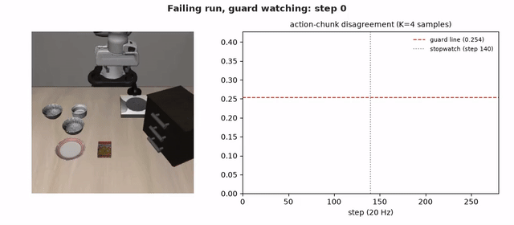

# Backstop

**Runtime failure detection for Vision-Language-Action robot policies.**

A VLA policy maps camera images and a language instruction straight to robot actions. When
it fails, it fails silently: its actions look the same whether the grasp is working or not.
Backstop watches a frozen policy as it runs and stops a run that is going wrong, sooner than
a timeout would. It never modifies or retrains the policy.

Built on [SmolVLA](https://huggingface.co/HuggingFaceVLA/smolvla_libero) in the LIBERO
simulator (MuJoCo, Franka Panda).

| Success (100 steps) | Failure (runs out the 280-step clock) |
|:---:|:---:|
|  |  |

*Same task, same policy, neighbouring start scenes. Videos:
[success](docs/assets/success_ep000.mp4), [failure](docs/assets/failure_ep001.mp4).*

## How it works

At every step the policy is sampled four times under different noise. When the four
planned action chunks disagree, the policy has no confident plan. The guard stops the run
when that disagreement crosses a line set from successful runs only, or when a stopwatch
runs out, whichever comes first.



*The failure above with the guard watching: it fires at step 48 (2.4 s); the stopwatch alone
would wait until step 140. [Video](docs/assets/guard_ep001.mp4).*

## Results

LIBERO-Spatial, 10 tasks, held-out half of the corpus, averaged over 20 random splits.

| | |
|---|---|
| Policy success rate (frozen, reproduced) | 70% (70/100); every failure is a stall to the step cap |
| **Time saved over a stopwatch** | **13.4 steps (0.67 s)** per failing run, at the same 5% false-stop budget |
| False stops on good runs (held out) | 4.3% (budget 5%, fixed before any guard existed) |
| Failures caught | 100% |
| Unseen suite (LIBERO-Object) | the spatial rule over-stops (17%); recalibrating on ~40 good runs brings it under 5% |
| Missing-object check (OWLv2 gate) | stops 28 of 30 runs with an absent object before the arm moves |

The baseline is a stopwatch, not chance. Because every failure here is a stall, a timer
alone already catches all of them within budget, so the only honest measure of a signal is
how much *time* it saves over the timer ([ADR-005](docs/adr/005-headline-vs-stopwatch.md)).
The guard beats the clock on about half the failures. Full results:
[evaluation](docs/evaluation.md); every signal tried: [experiments](docs/experiments.md).

## Recovery

Recovering when the guard fires was tested with two motions, each paired against the
unguarded run from the same recorded state (20 triggered episodes):

| Motion | Rescued | Spoiled | Change in success rate |
|---|---:|---:|---|
| Lift and back off, retry | 1 | 1 | 0.00 (p = 1.0) |
| Return to start pose, retry | 3 | 1 | +0.10 (p = 0.63) |

Neither helps significantly. A fresh try from the start succeeds on 42% of failed scenes,
but by the time the guard fires the arm has often moved the bowl. Details:
[recovery](docs/recovery.md).

## Quick start

Requires Python 3.12, a CUDA GPU (8 GB is enough) and `libosmesa6`.

```bash
uv sync --locked --extra dev --extra sim
```

```bash
just smoke          # 2-episode evaluation, about 5 minutes
just guard-reports  # recompute the headline from the recorded corpus
just test           # unit and contract tests
```

More commands: [runbook](docs/runbook.md).

## Repository

```
src/backstop/   env, policy, perturb, record, corpus, label, guard, recover, eval
cpp/            header-only C++17 port of the online guard (matches Python bit for bit)
scripts/        evaluation, guard freezing, recovery, verification, viewers
configs/        recording, evaluation and recovery configs; the locked metric
docs/           results, design notes and ADRs
```

## Scope

One policy, in simulation only: no real hardware, no fine-tuning, no cross-architecture
comparison. Because this policy only fails by stalling, the stopwatch is strong and the
signal's margin is small; a setting with early failures (collisions, drops) would give it
more to do.

## Documentation

- [Evaluation](docs/evaluation.md) · [Experiments](docs/experiments.md) ·
  [Recovery](docs/recovery.md) · [Corpus and data format](docs/corpus.md)
- [Engineering notes](docs/engineering_notes.md): the silent bugs we hit and the checks
  that now catch them
- [Throughput](docs/throughput.md) · [Runbook](docs/runbook.md) · [Failures](docs/failures.md)
- Decisions: [001 metric](docs/adr/001-metric.md) ·
  [002 checkpoint](docs/adr/002-checkpoint.md) ·
  [003 perturbations](docs/adr/003-perturbation-schema.md) ·
  [004 calibration](docs/adr/004-guard-calibration.md) ·
  [005 headline](docs/adr/005-headline-vs-stopwatch.md) ·
  [006 recovery metric](docs/adr/006-recovery-metric.md)

## License

Apache-2.0
